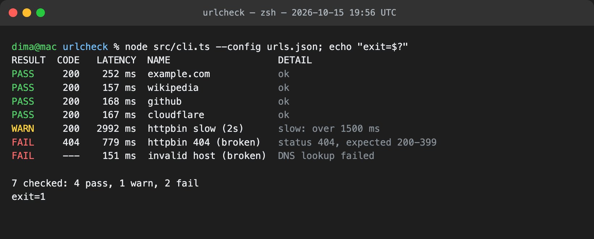
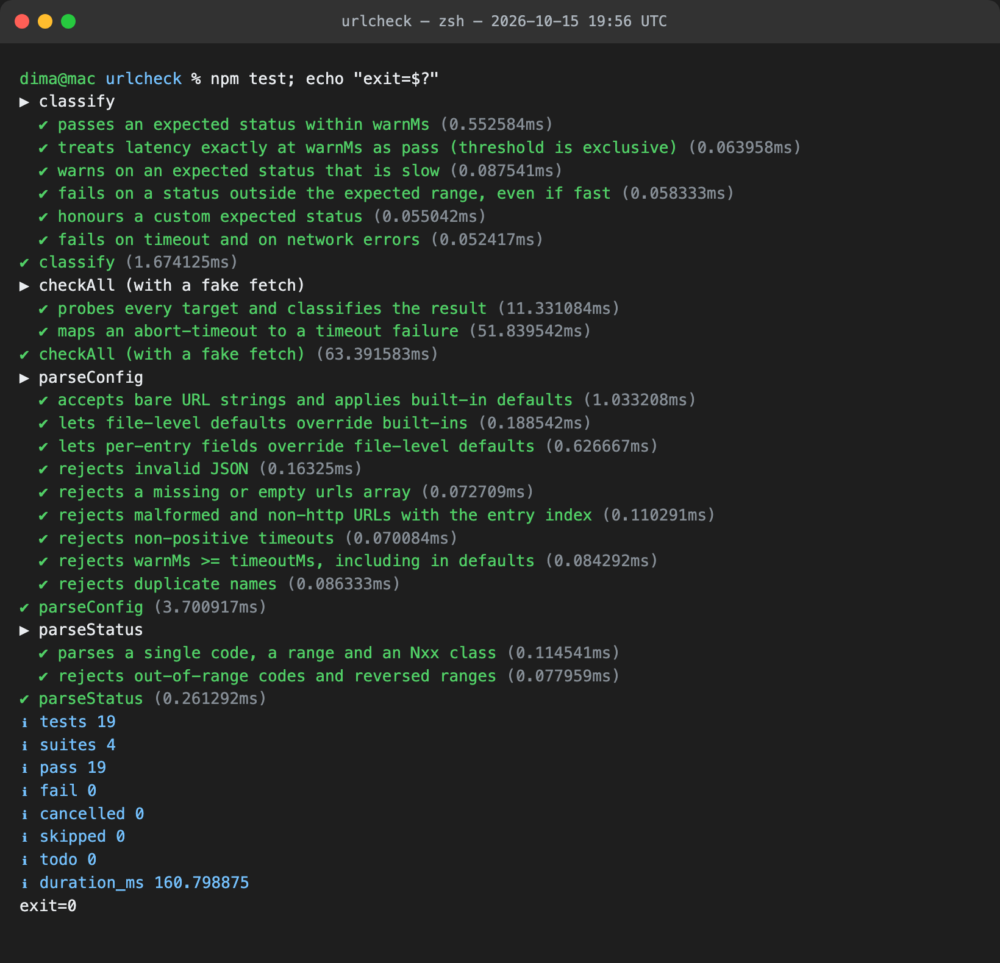

# urlcheck

A small command-line tool that reads a list of URLs from a JSON config file, checks each one concurrently and prints **status code, latency and a PASS / WARN / FAIL verdict** per URL.

```
RESULT  CODE   LATENCY  NAME                   DETAIL
PASS     200    252 ms  example.com            ok
WARN     200   2992 ms  httpbin slow (2s)      slow: over 1500 ms
FAIL     404    779 ms  httpbin 404 (broken)   status 404, expected 200-399
FAIL     ---    151 ms  invalid host (broken)  DNS lookup failed

7 checked: 4 pass, 1 warn, 2 fail
```

## Requirements

- Node.js **23.6 or newer** (tested on 26.9). Node runs the TypeScript sources directly, so there is no build step.
- Zero runtime dependencies. `typescript` and `@types/node` are dev-only, used by `npm run typecheck`.

## Setup

```bash
cd urlcheck
npm install
```

## Run

```bash
# check the URLs in urls.json (the default config path)
npm run demo

# or point it at any config file
node src/cli.ts --config path/to/urls.json

# machine-readable output
node src/cli.ts --config urls.json --json

# help
node src/cli.ts --help
```

| Option | Meaning |
| --- | --- |
| `-c, --config <file>` | URL list to check (default `urls.json`) |
| `--json` | print results as JSON instead of a table |
| `--no-color` | disable colours (`NO_COLOR` is also honoured; `FORCE_COLOR=1` forces them on when piping) |

**Exit codes:** `0` = everything PASS or WARN, `1` = at least one FAIL, `2` = bad config or arguments. This makes it usable as a CI or cron health gate.

## Test

```bash
npm test          # 19 tests: config parsing, result classification, fetch wiring with a fake fetch
npm run typecheck # tsc --noEmit, strict mode
```

## Config format

```json
{
  "defaults": { "timeoutMs": 8000, "warnMs": 1500, "expectStatus": [200, 399] },
  "urls": [
    "https://example.com",
    { "url": "https://api.example.com/health", "name": "API", "warnMs": 300, "expectStatus": 204 }
  ]
}
```

- Each `urls` entry is either a bare URL string or an object. Object fields override `defaults`, which override the built-ins (`timeoutMs` 5000, `warnMs` 1000, `expectStatus` 200-399).
- `expectStatus` accepts a single code (`204`), an inclusive range (`[200, 299]`) or a class (`"2xx"`).
- Validation errors name the offending entry, e.g. `urls[3]: "ftp://x" ... only http and https URLs are supported`. `warnMs` must be below `timeoutMs`, and names must be unique.

## How results are classified

| Verdict | Rule |
| --- | --- |
| **FAIL** | no response (timeout, DNS failure, connection refused, TLS error) **or** a status outside `expectStatus` |
| **WARN** | expected status, but latency **>** `warnMs` |
| **PASS** | expected status within `warnMs` |

Latency is measured from request start to response headers (time to first byte), following redirects. The body is discarded.

## Project layout

```
src/config.ts    parse + validate the config file → Target[]
src/classify.ts  pure pass/warn/fail decision (unit-tested)
src/check.ts     fetch with timeout, measure latency, map errors
src/format.ts    table output
src/cli.ts       argument parsing, exit codes
test/            node:test suites
urls.json        demo config: 4 healthy, 1 slow, 2 deliberately broken URLs
evidence/        screenshots and raw output of the demo run and test run
```

## Demo evidence

Live run on 2026-10-15 against 7 real URLs, including 2 that fail on purpose (a 404 and an unresolvable host). Raw output: [`evidence/demo-run.txt`](evidence/demo-run.txt).



Test run, 19/19 passing. Raw output: [`evidence/test-run.txt`](evidence/test-run.txt).


